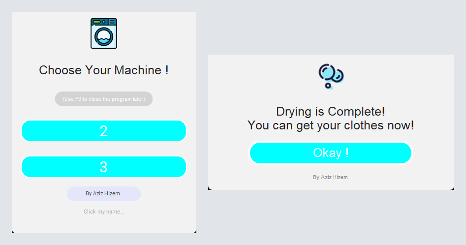

# ProxiWash Dryer Notifier

A small Windows desktop app built for a student residence laundry room (Student Village Arcueil), to stop having to walk downstairs to check whether the laundry is done. The laundry's machines report their status on [ProxiWash](https://www.proxiwash.com); this app watches that page for you and alerts you with a popup and a sound.

It is tailored to that building: the laundry page and the dryers it offers (**2** and **3**) are built in.



## How it works

1. A selection window asks which dryer to watch.
2. The app opens the laundry's ProxiWash page in **Microsoft Edge** through **Selenium** and switches to the drying machines.
3. It reads the selected dryer's status from the page and re-checks it about every 20 seconds, reloading the page when needed and recovering from stale page elements.
4. When it decides the cycle is over, it shows a **"Drying is Complete!"** window and plays a sound.
5. Press **F3** at any time to stop watching.

The Edge driver matching your browser version is downloaded automatically with `webdriver-manager`.

## Download

Get **`ProxiWash.exe`** from the [latest release](../../releases/latest) and run it. No Python needed; Microsoft Edge must be installed.

## Run from source

Requires **Windows**, **Microsoft Edge** and **Python 3.9+**.

```bash
pip install -r requirements.txt
python proxiwash.py
```

### Build the executable

```bash
pip install pyinstaller
pyinstaller ProxiWash.spec
```

The executable is written to `dist/ProxiWash.exe`, with the icons bundled inside.

## Tech stack

| | |
|---|---|
| Browser automation | Selenium, webdriver-manager (Edge) |
| UI | CustomTkinter |
| Alerts | Popup window and Windows sound |
| Global F3 shortcut | pynput |
| Packaging | PyInstaller |

## Version history

The commit history follows the app from its first script to the current version:

| Version | Main change |
|---|---|
| 1.0 | Selenium script watching one machine, Windows toast notification |
| 1.1 | Notifications through plyer |
| 1.2 | Choose the machine, completion popup |
| 1.3 | Dryers 2 and 3 |
| 1.4 | Machine selection window, sound alert, F3 exit key, PyInstaller build |
| 1.5 | Recovery from stale page elements |
| 1.6 | F3 hint in the selection window; Edge driver downloaded automatically |
| 1.7 | Redesigned windows with CustomTkinter |
| 1.8 | Icons bundled into the executable |

## License

[MIT](LICENSE)
